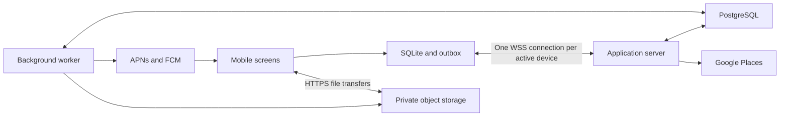

# A small backend for making plans happen

OutThere makes intimate and casual plans easier: float an idea, gather your people, settle the details, meet up and keep the memories.

Updated 7 October 2026. **Target design; not an implementation claim.** This supersedes earlier backend concepts where they conflict with the decisions below. Keep the existing Python/FastAPI server and Expo client as the starting point.

[Event protocol](protocol.md) · [Schema](schema.md) · [Mobile data layer](mobile.md) · [Build sequence](implementation.md)

## At a glance

- **One plan, one shared state.** Chat and Live read the same pins, polls, places and arrival updates.
- **Conversation stays light.** Temporary chat delivery; explicitly saved decisions and album media persist.
- **Start with people you know.** Circles, direct invitations and Ripples come first; discovery is optional.
- **Keep the stack small.** One server, one worker, one database. No separate services per feature.

## Architecture

One application server, one worker from the same codebase, PostgreSQL, private S3-compatible object storage, and local SQLite on each mobile device. SQLite remains useful for local server development. No separate chat service, matching service, Redis, search cluster or event broker initially.

All product requests, including login, renewal, queries, mutations, matching, upload coordination and sync, use WebSocket events. File bytes use signed HTTPS transfers. Google Maps fetches its own tiles. Health checks are operational HTTP endpoints. Background push alerts the device; reconnecting the socket retrieves app data.

The server owns shared product state. Screens read local data and queue actions. A command result means the server committed, not that another device received it. Durable product mutations commit data, action receipts, sync references and required jobs together. External calls do not hold database transactions open.

## Agreed scope

| Area | Behavior |
| --- | --- |
| Identity | Enter phone number; create or enter that account without OTP now; provider boundary for future OTP |
| Profile | Registered name, phone, display picture; verification remains unset |
| Display settings | Device-local language, distance/temperature units and time format; follow device defaults until overridden |
| Sync | All authorized profile, plans, circles, splits, albums and media metadata, paged; no historical chats |
| Messaging | Local history; temporary delivery; explicit pins become shared plan records |
| Live | Shared pins, polls, meeting point, one-time locations, arrivals and bring lists |
| Ripple | A soft ask with availability replies and a reviewed handoff to a plan |
| Backup | Device-only local archive; no app-managed cloud backup |
| Files | Persistent album media; on-demand download; expiring chat-only media |
| Devices | Independent session, cursor and delivery acknowledgements per device |
| Contacts | Optional local alias lookup, otherwise registered name; address book stays local |
| Places | Google Places through WS and Google Maps embedded on both platforms |
| Discovery | Deterministic public-plan ranking and Open-user matching |
| Notifications | Optional permission; WS while active, push in background |

Phone parsing checks format and canonicalizes with an explicit country code, not ownership. Anyone knowing a number can enter that account in this prototype. Make `AUTH_MODE=unverified_phone` explicit. OTP replaces the identity proof step later without changing account IDs.

### Proposed configurable defaults

These are design defaults, not additional user-approved product promises:

- Temporary chat payloads and chat-only files: 7 days maximum; delete earlier when all target devices finish delivery/download.
- Target devices: non-revoked devices active within the previous 30 days, captured when accepting the event. New devices receive future chat, not old history.
- Persistent sync references: 30 days; older cursors trigger a fresh metadata snapshot.
- Generic action receipts: 30 days; local retries stop after 7 days. Money operation IDs are permanent. Body-free chat ID/hash tombstones last 30 days.
- Signed file URLs: 5 minutes. Typing: expires after 5 seconds without refresh.
- Plan chat becomes read-only/archived 24 hours after plan end, including guest chat. Hello lasts 24 hours with one explicit 48-hour extension. Album grants persist until explicit removal; financial obligations persist until settled/corrected.

## Keep device choices on the device

The server stores shared facts and enforces access. Language, distance units, temperature units and time format default to the device’s settings or locale conventions. A user can override each locally or reset it to “Use device default”. Store only the override; following the device stays dynamic when its settings change. These choices require no server read, write, table or sync event, and are independent on each device.

Theme, UI filters/sort, dismissed tips, drafts, media download choices, contact aliases and permission state also stay local. Local choices survive app restarts and metadata resync. New installations start from their own device defaults; an explicit local archive restore can restore saved overrides.

Keep canonical values on the server: metres for distance, UTC instants for time, event timezones for scheduling and currency/minor units for money. Clients format those values. A display timezone is local; a plan’s venue timezone is a shared fact. Blocks, audience access, RSVPs, polls and debts remain server-owned because they affect other people.

Push is the small exception: the server needs a device’s token and enabled push categories to avoid sending unwanted background alerts. Turning push off unregisters its token. Store only this delivery policy, not a general settings object. Operational receipts, cursors and jobs remain bounded by retention; removing them would break reliable retries and offline recovery.

## Fewer records, fewer things to keep in sync

- **Derive access once:** room membership comes from the plan’s participants or the mutual Hello pair. Direct invitations already define invitees; only circle join routes need their own association.
- **Build views from facts:** Live reads the plan and its artifacts; Wrap reads existing decisions, arrivals and albums. Neither needs a separate stored copy. Participant counts, open poll totals and matching distance/time reasons are calculated when read.
- **Keep personal bookmarks local:** Scrapbook projects authorized album media with device-local favourite pins. Pins survive restart and can be included in a local archive, but do not sync to another device. This does not affect shared Chat/Live pins.
- **Keep money once:** expenses, shares and confirmed settlement allocations determine balances. Preserve corrections, reversals and permanent operation IDs; omit the duplicate ledger and stored balance totals.
- **Use small records for small features:** Ripple holds at most two typed time slots; a reply stores up to two selected slot IDs. Keep device sync progress on the device row and terminal delivery status on the existing body-free acceptance receipt.

These cuts reduce write paths and consistency work. Keep shared permissions, album grants, votes and bounded recovery state; they carry independent meaning. Add caches or extra tables only for measured query costs or a concrete new product requirement. See the [schema simplification list](schema.md) for the exact changes.

## Server source boundaries

Keep the existing flat `backend/src/outthere/` structure. Transport routes validated events; modules own product rules.

| Module | Responsibility |
| --- | --- |
| `main.py`, `contracts.py` | WS lifecycle, protocol versions, input validation, limits and structured errors |
| `auth.py` | Phone/OTP boundary, per-device sessions, token renewal and revocation |
| `people.py` | Profiles, circles, roles, invitations, membership, blocks and reports |
| `plans.py` | Plans, stops, audiences, approvals, RSVP, arrivals, cancellation |
| `rooms.py` | Room access, temporary messages, reactions, typing and device delivery |
| `money.py` | Expenses, shares, manual settlements, reversals and balances |
| `media.py` | Uploads, albums, signed access and file retention |
| `discovery.py` | Opens, public-plan ranking, anonymous overlaps, mutual hi |
| `artifacts.py` | Pins, polls, bring lists, Ripples and on-demand Wrap projections |
| `service.py`, `events.py` | Routing, deduplication, metadata sync and delivery coordination |
| `worker.py` | Push, expiry, thumbnails, abandoned uploads and delayed jobs |
| `integrations/` | Places, storage, push and future OTP adapters |
| `models.py`, `db.py`, migrations | Relational records, constraints and transactions |

## Feature behavior

### People and circles

Own-account responses include the phone; other-user projections expose it only when relationship permissions allow local contact lookup. No public phone directory. Normalize authorized phones locally and resolve contact name before registered name. Anonymous discovery cards never receive phone/name data. Denied/revoked contacts permission falls back to profile names.

Circles are invite-only, maximum 15 members, with owner/co-host/member permissions. Create/edit, invite/accept, leave/remove, sleep/wake are explicit actions. Transfer ownership before the owner leaves. Joining a circle does not automatically expose historical plans.

### Plans and live state

Plans have host, visibility (`private`, `link`, `public`), status, UTC interval, venue timezone, activity tags, currency, optional capacity and ordered geographic stops. Replace illustrative client `x/y` coordinates with latitude/longitude. Persist Google place IDs as references; fetched details obey provider caching rules.

Direct people receive invitations; selected circles provide a discovery/join route to their current members. Neither is an automatic RSVP or album grant. Removing a circle removes that route, not existing plan membership. No selected audience means host-only until people are invited or a revocable link is enabled. Public discovery shows a safe summary; room, album and money access require participation. Public/link join requests use host approval by default. Approvals and RSVP capacity checks are transactional. Full/cancelled/expired plans cannot accept new joins.

Live is the plan’s shared coordination page: arrival/en-route, current meeting point, pins, polls, shared locations and bring lists. Version checks prevent stale edits. Room permission follows its plan or Hello parent, including guest deadlines. Album grants and financial visibility are separately defined: room expiry must not erase debts or intended album access. Access removal emits a purge marker to devices; server reads and delivery recheck permission.

### Chat ↔ Live: one set of records

Every coordination record belongs to a `plan_id` and has one `artifact_id`, kind, creator, version and state. The plan room is derived from that plan. Chat renders a reference card; Live renders the same record. Opening either card leads to the same detail. Neither screen keeps its own poll totals or meeting point. Hello rooms do not have a plan Live page; these actions become available after creating a plan.

| Action | Shared behavior |
| --- | --- |
| Pin a message | Any current participant can explicitly save a text/link decision from Chat. Show the exact content being saved. The server validates the source in that plan’s unexpired delivery queue and copies only that selected content into a durable artifact. If the source has expired, offer a new standalone note for review; never claim it is a verified copy. |
| Manage pins | Creator or host/co-host can edit or unpin a note; only host/co-host changes the official meeting point. Unpin removes it from pinned views but retains the decision record; delete tombstones its content in sync. Pinning an existing poll/place references its artifact instead of copying it. |
| Create a poll | Any current participant can create a question with 2–6 options in Chat or Live. V1 uses one vote per participant, changeable until close. Both views show the same counts and own selection. Do not expose named ballots. |
| Close a poll | Default close is plan start; polls created after start require a future close no later than plan end. Creator or host/co-host may close early. An idempotent close saves the tally and pins one result. Ties and no votes stay explicitly unresolved; a result never silently changes time or venue. |
| Share a location | A participant chooses a place, drops a pin or explicitly shares their current point. A single location artifact appears in Chat and Live with label, coordinates/place reference, sharer and capture time. Directions use that point. It never starts continuous tracking or changes arrival status. |
| Set meeting point | Host/co-host promotes a shared place to the official meeting point. Only one is current per plan. Both screens update together; “Got it” is an explicit acknowledgement of that artifact version, not a message read receipt. A changed point needs fresh acknowledgement. |
| Bring something | Shared item claims are transactional; concurrent claims cannot assign one item twice. Chat and Live show the same owner. |

Create/update, version increment, sync references, deduplication receipt and a body-free chat notification job commit together. The worker delivers an `artifact.changed` reference with `plan_id`, `artifact_id` and version; the client hydrates through normal sync. Notification delivery can retry without creating duplicate cards. Chat delivery expiry never deletes the underlying decision. A new device can load current cards through metadata sync without receiving historical conversation.

Pin promotion is an explicit retention exception: only the reviewed selected text/link is saved, never adjacent conversation, attachments or a full transcript. Durable artifacts follow plan participant access and survive room archive. Personal “my location” points instead expire at plan end or when withdrawn by their sharer; cleanup clears coordinates and emits tombstones. Manual meeting places persist as plan details. Do not copy personal position history into logs, notifications, Wraps or backup snapshots; store expiring personal coordinates in the temporary schema and hydrate them only while valid. Location permission denial still allows place search or a manual pin.

Poll votes and closure lock the same poll row and check server time, so a late vote cannot enter a closed result. Options cannot change after the first vote; create a replacement poll. Moving the plan start recomputes still-open default deadlines and closes overdue polls; closed results never reopen automatically. Cancellation closes open polls without picking a winner and expires personal locations. Room archive disables coordination writes; normal removal/privacy cleanup remains available.

### Ripple: a soft ask before a plan

A Ripple asks “Anyone up for something?” without creating attendance or a chat room. The sender enters a short idea, selects circles and/or people, optionally suggests a place and up to two dated time windows, then sends it to a deduplicated audience snapshot. It appears on the relevant Circle Board and recipient Inbox. Only the sender and recipients can access it; later circle joiners do not inherit access.

- **Ask:** idea up to 240 characters, optional place hint, 0–2 slots with start/end and timezone, reply window of 24/48/72 hours. Close at the earlier of that window or 30 minutes before the earliest slot. Reject an already elapsed deadline. Free-text timing notes never override dates.
- **Reply:** “Up for it”, “Another time” or “Can’t make it”, with an optional note up to 140 characters. Interested recipients can select multiple slots; no selected slots means flexible. One replaceable response per recipient until the server deadline. Count each person once. The sender sees named replies; other recipients see aggregate counts and their own response.
- **Review:** the sender chooses a slot, reviews the title, stops, time and invitees in the plan form. Interest is only a suggestion for invitations; it is never an RSVP. No automatic conversion or plan creation from reply counts.
- **Convert:** final submission atomically creates one plan and its invitations, sets `converted_plan_id`, closes the Ripple and emits sync/jobs. Lock the Ripple; duplicate conversion returns the same plan even after a lost response. New conversion after expiry or manual close is rejected. Replies racing conversion either commit first or receive `expired`.
- **Finish:** state is `open → converted / closed / expired`. The sender can close early; the worker expires it, and every read/write also enforces the deadline. Closed cards remain a compact summary with a plan link where authorized. Send the initial ask and conversion update; avoid a push for every reply.

### Chats

Rooms belong to plans or mutually accepted Hello overlaps. Circles have Boards, not general chat. Support text/emoji, links, location, emoji reactions, voice, image, video and typing. Location is a single shared point, not continuous tracking. V1 displays links without fetching server-side previews.

Store temporary payloads once and deliveries per target device, including the sender's other eligible devices. Give durable chat events a room sequence. Devices persist before acknowledging; duplicate IDs upsert. Reactions reference message IDs, with bounded local buffering if the original has not arrived. Typing is online-only, never stored or pushed. Internal delivery acknowledgements do not introduce visible read receipts.

Temporary chat uses a separate PostgreSQL schema excluded from routine backups, with its own transaction containing payload, target rows and body-free acceptance receipt. No ordinary chat bodies in persistent sync, generic receipts, logs, analytics or backup archives on the server. Explicitly saved pin content is a durable plan artifact and follows its separate retention policy. This is not end-to-end encryption; the server can read queued content. Cleanup also covers object versions and any configured storage retention.

New devices do not get already-deleted chat. Offline devices receive pending events until expiry; expired delivery is explicitly reported. Local backup is the only v1 path for restoring older chat.

### Media and albums

`media.prepare` → signed upload → `media.complete` → validate actual size/type/checksum → ready → send or link. Only ready files are usable. Object keys are not permissions; signed reads require current access. Refresh expired URLs through WS. Keep originals and generated thumbnail references in metadata, not file bytes.

Album references keep media persistent independently of chat. Chat-only target devices must download into durable local chat storage before acknowledging the attachment. Metadata-only initial sync does not imply attachment bytes can be deleted before receipt. Postponed download beyond expiry shows unavailable media.

Promotion into an album creates a durable reference transactionally; cleanup locks/rechecks references before deleting, so promotion and expiry cannot race. Hide/remove revokes server access and syncs tombstones. Already downloaded/exported files cannot be remotely erased. Scrapbook projects authorized album media and device-local favourite pins, not duplicated objects or server bookmark rows. Profile pictures are durable media with profile visibility.

### Splits

One currency per plan, integer minor units, deterministic rounding, equal/custom shares summing exactly to the expense. Record payer and debtors; net by person within each currency, per plan and across plans. Settlements allocate against specific obligations to prevent double application. Compute balances from these records; there is no separate ledger or balance table.

V1 tracks manual settlements confirmed by the counterparty; no payment processing. Reject self-settlement, mixed currency, over-allocation and unauthorized changes. Posted corrections use reversals/replacements. Cancellation never silently zeros money already spent. Product references to automatic refunds need a future payment adapter.

### Discovery without a profile interest score

Users have a name, phone and display picture; there is no interests field to score. Do not infer a taste profile or show a compatibility percentage. Plan activity tags and explicitly selected Open/search preferences can be filters for that request only.

Public plans: filter published/open state, requested time overlap, selected area/radius, capacity, blocks/pauses and eligibility. Sort by greatest time overlap, then shortest distance, then start time and ID. Return concrete reasons such as “fits your time” and “within your area”. With no requested time, skip overlap ordering; without an area, ask for one rather than assuming the device location. Suggestions never auto-join anyone.

Open users: require two active Opens, overlapping time, distance within both radii and symmetric block/restriction checks. Apply an activity filter only when explicitly supplied. Order by overlapping minutes, distance and canonical pair ID; persist one overlap per pair, without a matching score. Cards expose only the permitted anonymous summary, common time and distance band. Pass closes quietly; mutual hi transactionally creates exactly one Hello room.

Preserve current product Open/card/Hello limits, coarse-density gate (at least three eligible candidates) and delivery jitter. Below the gate, show an honest insufficient-density state. Verified-tier filters stay disabled until verification exists. Use a selected area or foreground-consented location; no background tracking. Start with indexed time/bounding-box filtering and exact distance; add a geo extension only when needed.

### After the plan

Wraps are on-demand views of structured decisions, arrivals and authorized albums, never retained conversation or personal location points. They reflect later corrections/removals and need no stored summary or generation job. Scrapbook reads authorized albums and local favourite pins without duplicating files. Shared plan pins remain server artifacts. Automated curation, paid tickets, natural-language interpretation and real payments remain later enhancements.

## Notifications and operations

Register/update push tokens per device over WS. Notify meaningful messages, invitations, approvals, plan changes, matching and money activity according to the registered device’s enabled push categories. Language and display settings are not part of push registration; use stable event/resource identifiers and client-localized in-app labels. Suppress typing, silent photo hiding and per-response ripple chatter. Push contains generic text and event/resource IDs, not chat bodies, phones or precise location.

A socket connection is not proof of delivery: push jobs wait a short acknowledgement grace period, deduplicate by event/device and recheck current access. Foreground room users get an in-app indication. Invalid tokens are removed. Provider retries may still duplicate pushes; stable IDs let clients collapse them. Denied permission does not break app sync.

Use WSS outside localhost. Bound frames, request rates, inflight work and outbound buffers. Authenticate before subscriptions; recheck permission at command and delivery time. Slow clients disconnect and catch up from cursors. Worker jobs use leases and retry backoff. Measure connection count, command latency, sync lag, delivery age and job failures without private payloads.

Back up persistent PostgreSQL data and durable objects, excluding temporary delivery. Test restore. Start one server and one worker; shared pub/sub later improves wake-up latency but never replaces durable recovery.

## Precedence and platform references

Recorded design decisions override the earlier product document: prototype phone sign-in uses no OTP, typing is allowed, chat delivery is temporary, and maps use Google Maps with Places. These choices are explicit v2 requirements. No online dots or visible read receipts are added. The proposed shared room deadline above resolves conflicting guest/archive deadlines in the older product document; keep it configurable and centralize it on the server.

[Expo SQLite](https://docs.expo.dev/versions/v57.0.0/sdk/sqlite/) · [Contacts](https://docs.expo.dev/versions/v57.0.0/sdk/contacts/) · [Notifications](https://docs.expo.dev/versions/v57.0.0/sdk/notifications/) · [Google Maps in Expo](https://docs.expo.dev/versions/v57.0.0/sdk/map-view/) · [Places caching/display policy](https://developers.google.com/maps/documentation/places/web-service/policies) · [Android background networking](https://developer.android.com/training/monitoring-device-state/doze-standby) · [iOS suspension](https://developer.apple.com/documentation/uikit/extending-your-app-s-background-execution-time).

## Access decisions

| Relationship / transition | Access rule |
| --- | --- |
| Own profile | Phone, registered name and profile picture |
| Another person's profile | Registered name/picture for an authorized relationship; phone only for accepted shared-circle or plan participation, never public discovery |
| Invited or pending approval | Safe plan summary; no conversation, album or money access |
| Accepted participant | Plan and coordination; room writes until archive; financial reads only own obligations and expenses where payer/debtor, with host managing plan expenses |
| Album creation / RSVP in | Grant current RSVP-in participants; a later RSVP-in grants existing albums |
| RSVP out / cancellation / archive | Preserve existing album grants and financial obligations; archive disables coordination writes |
| Explicit leave / removal | Purge plan/room/artifacts and revoke album grants; retain access to own financial obligations until resolved |
| Block | Remove discovery/contact visibility and direct delivery between the pair, hide each other's content projections and revoke corresponding album visibility; retain own financial obligations; shared plan membership is not automatically erased |

V1 does not yet enforce this v2 permission matrix. Each remaining slice must implement and test its applicable rows before declaring the feature complete.
